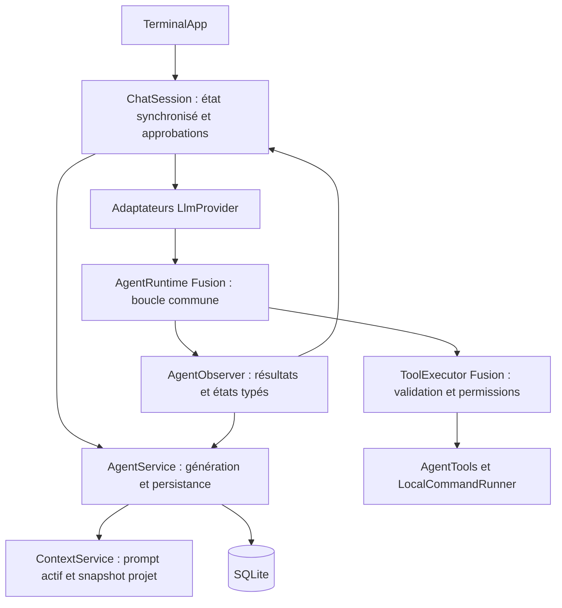

# Suivi de la phase 2 — moteur agentique P1

Implémentation du 18 octobre 2026, après le [correctif shell P0](shell-security.md). Ce suivi couvre la phase 2 de la [roadmap](roadmap.md). Le rapport initial, ses scores et ses empreintes restent historiques ; cette livraison ne revendique aucune parité supplémentaire pour les sous-agents, MCP ou les extensions de tools.

## Comportements livrés

- Build → Plan → Build conserve la session et envoie le prompt de l’agent effectivement sélectionné. Les permissions sont recalculées à chaque exécution.
- Les instructions du projet sont enregistrées séparément dans la partie système initiale. La reprise utilise le prompt courant de l’agent et le snapshot de projet enregistré. Les anciens enregistrements sont lus sans migration : leur suffixe `Project instructions:` est conservé, leur ancien préfixe agent est remplacé. Le texte historique en base reste intact.
- Un seul `AgentRuntime`, géré par Fusion, orchestre les tours Ollama NDJSON, Chat Completions SSE et Responses SSE. Les adaptateurs conservent leurs formats réseau, parsing, métriques et bornage du contexte.
- `ToolExecutor`, également géré par Fusion, centralise validation, permissions et effets. Il vérifie lui-même DENY avant tout callback d’approbation ; ASK sans source d’approbation est refusé. Le précontrôle shell de phase 1 reste appliqué avant le processus. La TUI fournit l’interaction d’approbation et affiche les résultats.
- `ToolResult` distingue `SUCCESS`, `DENIED`, `FAILED` et `CANCELLED`. Un code de sortie non nul ou un timeout donne `FAILED`. Aucun préfixe textuel n’est utilisé pour déterminer un statut. Les callbacks historiques retournant une chaîne restent compatibles et représentent explicitement un résultat réussi.
- `AgentObserver` transmet les notifications typées. `AgentState` couvre IDLE, THINKING, TOOL_CALLING, WAITING_PERMISSION, WAITING_TOOL, COMPLETED, FAILED et CANCELLED. `ChatEvent` expose les changements d’état et les résultats typés via `ToolCompletion` ; l’alias `OllamaClient.Observer` préserve les intégrations existantes.
- Un échec/refus d’outil revient au modèle, qui peut poursuivre. Une annulation arrête la boucle et n’ouvre aucun nouveau tour. Les limites de tours sont communes, y compris l’absence de tour assistant vide supplémentaire à la limite.
- SQLite conserve les issues structurées : refus = exécution `CANCELLED` avec autorisation `DENIED`, erreur = `FAILED`, interruption = `INTERRUPTED`. Les résultats terminés incluent statut, code de sortie, timeout et troncature dans leur payload. Aucun changement de schéma SQL.
- L’annulation persiste les fragments reçus et le statut interrompu, même si un transport retourne normalement après avoir effacé son interruption. Un appel interrompu sans résultat est exclu du contexte reconstruit ; aucun effet n’est rejoué automatiquement.

## Architecture effective



Les adaptateurs fournissent une source de tours et un encodage d’historique `ToolHistory` au runtime. Le runtime n’accède ni au terminal, ni aux credentials, ni aux repositories. `ToolExecutor` n’accède ni à la TUI ni aux providers. `ChatSession` garde la responsabilité des approbations interactives et de leur mémorisation ; `AgentService.Generation` assure les écritures transactionnelles et la libération du verrou. Les tests construisant directement les services disposent d’un runtime/executor de repli avec les mêmes classes, sans moteur alternatif.

## Preuves reproductibles

| Critère phase 2 | Code principal | Test exécuté |
|---|---|---|
| Prompt actif et même session après switch | `session/ContextService`, `ConversationService`, `AgentService` | `ParityAuditTest.refreshesTheEffectivePromptWhenSwitchingBuildPlanBuild`, `AgentEngineParityTest` |
| Snapshot projet conservé à la reprise ; ancien format sans mutation | `ContextService.reconstruct` | `AgentEngineParityTest`, `ContextServiceTest.updatesLegacyAgentInstructionsWithoutMutatingSavedProjectSnapshot`, `explicitProjectSnapshotIsUnambiguousEvenWhenAgentPromptContainsLegacyMarker` |
| Boucle commune, ordre de plusieurs calls, limite de tours | `ai/AgentRuntime` | Six cas `AgentRuntimeTest`, tests de streaming existants |
| Policy au point d’exécution, callback incapable de relaxer DENY | `ai/ToolExecutor` | `ToolExecutorTest`, `CommandToolTest`, refus non annoncé dans `ParityAuditTest` |
| Refus/échec/annulation et diagnostics structurés | `ToolResult`, `AgentService.Generation` | `AgentRuntimeTest`, `ToolExecutorTest`, `AgentEngineParityTest` |
| États d’approbation et annulation | `ChatSession`, `AgentRuntime`, `ProviderEvents` | `CommandToolTest`, `ResponsesProviderTest`, `AgentRuntimeTest` |
| Annulation tardive et fragments persistés | `ChatSession` finalisation | `PersistentStreamingTest.cancellationWinsEvenWhenTransportReturnsNormallyAfterClearingInterrupt`, tests interruption existants |
| Même parcours sur les quatre adaptateurs | `OllamaClient`, `ResponsesLlmProvider`, `ToolHistory` | Les quatre variantes de `AgentEngineParityTest.buildsPlansSwitchesBackAndResumesWithTypedOutcomes` |

Les chemins Java du tableau sont sous `src/main/java/fr/openobject/ai/syleks/` ; les tests sous `src/test/java/fr/openobject/ai/syleks/`.

Le scénario intégré utilise de véritables adaptateurs HTTP contre des serveurs locaux simulés : lecture d’un fichier Java, édition, exécution de Java pour vérifier la modification, commande sortant avec le code 7, refus de write/bash dans Plan, retour Build puis fermeture/réouverture SQLite. Il contrôle les associations protocolaires des résultats, les 12 requêtes et leurs métriques persistées, le même UUID de session et le snapshot projet malgré un changement d’AGENTS.md. Les workspaces et credentials sont fictifs et temporaires ; aucun abonnement ou serveur Ollama permanent n’est requis.

```bash
mvn -B --no-transfer-progress \
  -Dtest=AgentRuntimeTest,ToolExecutorTest,AgentEngineParityTest,ContextServiceTest,ParityAuditTest,CommandToolTest,PersistentStreamingTest,ResponsesProviderTest test
mvn -B --no-transfer-progress clean verify
```

## Résultats de validation

Java 25 (Zulu), Maven 3.9.16. La commande exécutée `mvn -B --no-transfer-progress clean spotless:apply verify` termine le **18 octobre 2026 à 22:21:00 +02:00** avec **BUILD SUCCESS : 347 tests, 0 failure, 0 error, 0 skipped**. Elle inclut compilation Java 25, génération des composants Fusion, suite complète, packaging du JAR exécutable et contrôle Spotless. La phase 1 comptait 332 tests : 15 cas supplémentaires exécutés, plus des assertions renforcées dans les tests existants.

Un premier passage ciblé avait signalé une assertion obsolète de `ResponsesProviderTest` qui supposait le texte en premier événement. Le test recherche désormais les événements TEXT_DELTA et vérifie aussi l’état FAILED ; les fragments conservés et l’absence de COMPLETED après une erreur restent vérifiés. Le passage complet ci-dessus réussit.

Après le dernier ajustement du retour de WAITING_PERMISSION vers WAITING_TOOL, `mvn -B --no-transfer-progress clean verify` a également réussi à **22:24:18 +02:00**, avec les mêmes **347 tests réussis**, packaging et contrôle de format. Les beans générés Fusion injectent effectivement `AgentRuntime` dans les adaptateurs et `ToolExecutor` dans `ChatSession`.

Le JAR produit a aussi exécuté `session list` avec un home, workspace et répertoire de données sous `/tmp` : code de sortie 0, catalogue vide attendu, aucun provider contacté. Ce contrôle n’est pas une validation interactive de la TUI.

Journaux de cette session : `/tmp/syleks-engine-verify.log` et `/tmp/syleks-engine-final.log`, détails Maven dans `target/surefire-reports/`. Ces fichiers générés ne sont pas nécessaires pour reproduire la campagne. `git diff --check` passe.

## Limites et suites

- Aucun test avec modèle distant réel, abonnement payant ou manipulation humaine d’un terminal interactif. La validation de transport utilise les formats simulés, pas les capacités intrinsèques de chaque modèle.
- Les états de travail et d’attente sont transitoires en mémoire ; SQLite conserve les statuts durables de messages, sessions et outils, sans journal de toutes les transitions. WAITING_TOOL désigne aussi l’attente du handler ; une demande interactive produit ensuite WAITING_PERMISSION puis WAITING_TOOL à l’approbation.
- Le snapshot des anciennes sessions est récupéré à partir du premier marqueur historique ; les anciens textes dont le prompt agent contenait déjà ce marqueur sont intrinsèquement ambigus. Les nouvelles sessions possèdent un champ explicite et évitent cette ambiguïté.
- Les effets externes autorisés restent non transactionnels. Pas de garantie exactement une fois, de rollback des commandes, ni de sandbox OS. Les limites shell de phase 1 restent applicables.
- Le catalogue d’outils reste fixe. Registre extensible, sous-agents avec sessions enfants, parallélisme coordonné, MCP, hiérarchie avancée d’instructions et compactage sémantique relèvent des phases suivantes.
- `report.json`, `source-manifest.json`, `test-results.json` et les scores initiaux ne sont pas régénérés : leurs empreintes décrivent le checkout audité précédemment. Un nouvel audit est nécessaire pour annoncer une couverture et des scores globaux actualisés.
