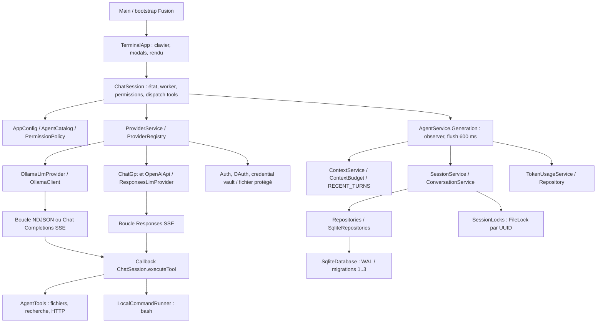
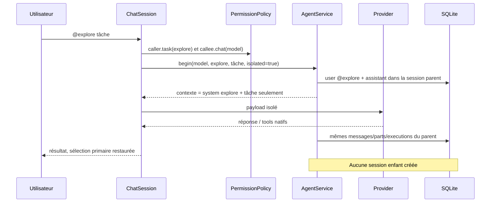
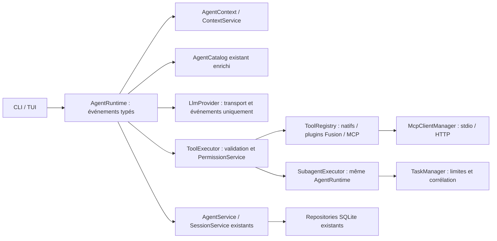

# Architecture observée et cible proposée

Syleks possède une **boucle agentique réelle**, une persistance structurée et une TUI opérationnelle au niveau des tests. La délégation est un chemin manuel isolant le payload, sans arbre de sessions. MCP et plugins tools ne sont pas implémentés. Aucun changement de production n’a été réalisé pour cet audit.

## Structure et bootstrap

Module Maven unique, release Java 25 ; Yupiik Fusion 1.2.0, annotation processor et conteneur `ConfiguringContainer`, Fusion CLI/JSON, JLine 3.30.3, sqlite-jdbc 3.53.2.0, Nimbus JWT 10.10 ; JUnit 5.13.4. Compilation génère beans, proxies et codecs ; Shade produit le JAR exécutable ; Spotless AOSP vérifie les sources. `.github/workflows/ci.yml` exécute déjà `clean verify` sous Java 25 puis un smoke CLI/SQLite.

## Responsabilités identifiées

| Composant | Rôle réel | Limites |
|---|---|---|
| `Main`, `TerminalApp` | CLI, sessions/provider/config ; commandes TUI, picker et approvals | Pas de serveur applicatif, run headless agentique ni API task/MCP |
| `ChatSession` (1030 lignes) | Synchronisation des messages UI, agent/model, worker virtuel, cancel, policy/ASK, tools, save | Domaine/exécution/présentation mêlés, un seul travail actif |
| `AgentCatalog`, `AgentDefinition` | JSON/Markdown global puis projet ; modes et paramètres | Chargé au démarrage ; absence disable/hidden, namespace tools fixe |
| `PermissionPolicy` | Règles ordonnées sur opération/cible, allow/ask/deny | Chaîne shell entière, pas analyse syntaxique ; agent peut remplacer le global |
| `AgentService.Generation` | Transaction des messages/calls/results, flush et fin, usage | Invocation sous-agent stockée dans parent ; heuristiques String pour erreurs |
| `ContextService` | Prompt partagé + AGENTS racine ; reconstruction de paires calls/results ; budget | Ancien system prioritaire après switch ; envelope tools dépend de `openAiCompatible` |
| `ContextCompactor` | Sélection de tours récents entiers | Aucun résumé généré, aucun `/compact` |
| `SessionService` | UUID/projet, open/resume/create/list/rename/delete/fork/export | Pas import, archive accessible, fork au message ou enfants task |
| `SqliteDatabase`, repositories | Connexions courtes, transactions réentrantes, WAL, migrations | Effet fichier/process et commit SQLite non atomiques |
| `OllamaClient` | Sérialisation/parsing NDJSON et ancien Chat Completions ; boucle | Orchestration partiellement embarquée dans l’adaptateur réseau |
| `ResponsesLlmProvider` | SSE Responses, instructions/input, completion stricte, tool calls et usage | Deuxième implémentation de la boucle ; capacités modèle inconnues |
| `ProviderRegistry/Service` | Enregistrement de providers, sélection, comptes, politique cloud | Registre provider extensible ne signifie pas registre tool extensible |
| `AgentTools`, `ToolSchemas` | Huit tools + bash, validation locale, limites et gate | Catalogue statique, résultats String, pas apply_patch/skill/question/todo/task/MCP |
| `LocalCommandRunner` | Bash cwd fixe, stdin fermé, capture fusionnée, timeout, cleanup descendants | Autorité de l’utilisateur hôte ; environnement hérité ; pas sandbox OS |
| `TokenUsage*` | Événement par requête, idempotence, cache/reasoning non doublés, UI | Pas dimension enfant/agent ; prix/coût non inférés |

## Sous-agent et session : flux réellement vérifié

Le schéma `parent_session_id` existe pour les forks. Ce n’est pas une preuve de délégation persistée. Un vrai `@explore` a laissé une seule session après réouverture ; la requête enfant ne contenait pas le marqueur fictif confidentiel parent. Le parent peut retrouver la réponse dans son historique ultérieur, mais aucun moteur ne reprend spontanément le raisonnement après un résultat `task`.

## Sécurité et concurrence

Les contrôles sont dans le chemin d’exécution `ChatSession`, pas seulement dans le renderer. ASK suspend le worker sur future ; la TUI répond par un identifiant de demande. Les grants always restent limités à l’agent et à l’opération, sans remplacer DENY. Les file tools refusent chemins extérieurs et symlinks ordinaires, fichiers binaires/UTF-8 malformés, sorties trop grandes. Cela ne constitue pas une preuve contre une course de changement de symlink entre check et ouverture.

Bash exécute `/bin/bash -c` avec l’environnement hérité et les droits hôte. Un refus read/write dédié n’est donc pas une sandbox shell. L’écart démontré est plus précis : une commande composée profite du pattern autorisé d’une première commande et ne fait pas appliquer le DENY de la seconde. Les restrictions parent-agent ne doivent pas être confondues avec des interdictions de session héritées : OpenCode distingue lui aussi ces niveaux.

`ChatSession` synchronise l’état mutable ; le worker ne peint pas le terminal. `AgentService` flushe avec scheduler virtuel ; locks OS et WAL coordonnent les sessions entre processus. Plusieurs sessions ne protègent pas les mêmes fichiers workspace. Pas de scheduler de sous-agents ni de réservation de fichier.

Les credentials LLM sont distincts des sessions : Secret Service si disponible, fallback JSON protégé 0600, répertoires 0700. Le fallback n’est pas du chiffrement au repos. Les tests existants vérifient des redactions et l’absence de tokens d’auth dans les exports ; tout secret présent dans une conversation, un tool result ou des arguments peut malgré tout être persisté/exporté. Aucun compte réel n’a été ouvert pour cet audit.

## Architecture cible, sans refonte durant l’audit

Conserver `AgentCatalog` au lieu d’ajouter un doublon `AgentRegistry` ; enrichir `AgentDefinition`. Extraire graduellement la boucle commune des deux adapters dans un runtime Fusion, avec `ToolExecutor` vérifiant systématiquement une policy effective. Les adaptateurs ne possèdent plus la politique de tours. `SubagentExecutor` appelle le même runtime avec une session enfant, un contexte explicitement transmis et un plafond de permissions de session. `TaskManager` gère profondeur, concurrence, cancel/deadline et résultat corrélé.

Réutiliser `SessionService`, `ConversationService`, `ContextService` et les repositories ; ajouter le cycle de vie enfant, résumé généré, journal d’exécution et schémas nécessaires par migrations ciblées. Un `McpClientManager` alimente le même `ToolRegistry`, sans accès direct non contrôlé aux handlers. Séparer authentification MCP et comptes LLM. Événements typés de texte, tool, permission, usage, enfant et état permettent à la TUI actuelle de rester consommatrice, sans réécriture.
