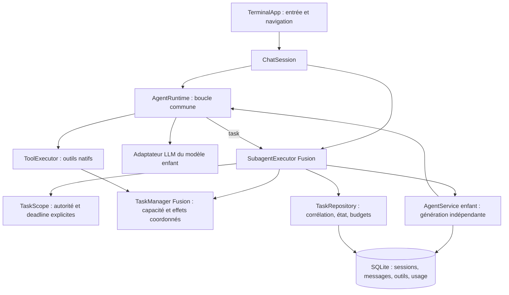

# Suivi de la phase 4 — sous-agents P1/P2

Implémentation du 18 octobre 2026, après [les agents de phase 3](agents.md). Ce suivi couvre la phase 4 de la [roadmap](roadmap.md). L’audit initial et ses scores restent historiques ; les outils extensibles, MCP et le compactage sémantique relèvent toujours des phases suivantes.

## Résultat fonctionnel

Le tool `task` effectue une véritable délégation, disponible aux modèles autorisés comme aux invocations manuelles `@name` et `/subagent`. Il crée une session enfant indépendante, exécute le même runtime et les mêmes adaptateurs/outils, puis rend un résultat structuré au parent. Un enfant peut lui-même déléguer dans les bornes autorisées. Explore est maintenant intégré, avec une policy de lecture/recherche et un template Markdown éditable.

La syntaxe native accepte soit `{agent,prompt,timeout_seconds?}`, soit `{tasks:[{agent,prompt},…],timeout_seconds?}` pour 1 à 8 tâches. Les lots exécutent des enfants concurrents, collectent les résultats dans l’ordre de demande et conservent les succès de frères dont un autre échoue. Les appels de tools ordinaires restent séquentiels ; le lot est le point explicite de parallélisme.

Chaque enfant reçoit son prompt d’agent, les instructions globales/projet configurées et sa tâche explicite. Aucun transcript, résultat d’outil ou credential du parent n’est copié automatiquement dans son contexte. Son modèle/provider est propre à sa définition, avec héritage du modèle parent en l’absence de surcharge ; son compte est résolu pour ce provider.

Les décisions d’autorisation sont calculées au point d’exécution sur les policies effectives de l’enfant **et de tous ses ancêtres** : DENY domine, ASK nécessite une approbation, ALLOW ne peut élargir un refus ancestral. La permission `task` est évaluée sur le nom du délégué, avec les patterns existants. Les contrôles shell granulaires restent applicables à chaque policy. Les prompts d’approbation utilisent le panneau TUI existant et sont sérialisés ; un timeout ne laisse pas de demande orpheline.

## Architecture livrée



`AgentService.child` crée une instance de génération indépendante partageant repositories, configuration et stockage de consommation. Le singleton de session principale ne change pas sa sélection pendant la délégation. Chaque enfant a son propre lease de session, son buffer, son flusher et son historique.

`TaskScope` transporte explicitement l’ascendance des agents et l’état d’annulation, sans variable globale ou contexte hérité implicitement par thread. Le timer et les contrôles du scope empêchent un transport qui efface son interruption de déclencher ensuite un nouvel outil. Les workers sont rejoints avant libération du lease parent, y compris pendant le shutdown.

`TaskManager` applique une capacité aux tours LLM et handlers natifs des enfants. Un parent attendant une délégation ne détient aucun permis : une récursion avec capacité 1 reste possible sans interblocage. Un verrou lecture/écriture sur le workspace permet les lectures concurrentes et sérialise écritures, éditions et commandes contre les autres effets natifs dans le même processus. Il ne coordonne pas les éditeurs externes ou plusieurs CLI et ne réalise pas de fusion transactionnelle de plans concurrents.

## Persistance et quotas

Migration transactionnelle **V004**, schéma SQLite **4** :

- `agent_tasks` distingue les enfants d’exécution des forks. Il conserve session parent/racine, call ID, message parent, agent, ascendance, statut, nombre de tours et diagnostic. Le message parent permet de corréler correctement des IDs de tool calls réutilisés à plusieurs tours. Les résultats parents contiennent aussi `childSessionIds` dans leurs parties structurées.
- `agent_task_budgets` réserve atomiquement les tâches créées et tours modèle tentés par racine. Les compteurs survivent au redémarrage et à la suppression d’un historique enfant. Une nouvelle racine ou un fork racine possède un nouveau budget ; ce mécanisme n’est pas un plafond monétaire exact.
- Les messages, appels/résultats natifs, fragments et consommations utilisent les tables existantes. Un échec LLM marque le message ERROR ; annulation et timeout le marquent INTERRUPTED. Les statuts de tâche distinguent COMPLETED, FAILED, CANCELLED, TIMED_OUT et INTERRUPTED après récupération de crash.

Les limites configurables sont décrites dans [le guide des sous-agents](../../subagents.md) : profondeur 3, capacité 4, 32 enfants et 128 tours enfants par racine, 16 tours par enfant et deadline de 120 secondes par défaut. Tous les plafonds sont finis. Les limites propres à l’agent peuvent réduire le plafond commun de tours ; `max_rounds: -1` ne le supprime pas. Un agent déjà présent dans l’ascendance ne peut être réinvoqué récursivement. Les frères peuvent utiliser le même agent.

Un résultat retourné au parent reste du JSON valide, borné à 32 000 octets UTF-8, avec un résumé par enfant borné à 16 000 points de code, un indicateur de troncature et des IDs de corrélation conservés. L’historique enfant garde la réponse reçue. Les diagnostics d’exceptions sont bornés par les mécanismes existants.

## Navigation, restauration et consommation

`/children` présente les enfants directs ; `/session ID` ouvre un historique ; `/parent` remonte d’un niveau. Le picker existant marque les branches avec `↳`. Les historiques enfants affichent leur statut et diagnostic et restent exportables après redémarrage. Ils ne peuvent ni générer, ni changer de modèle, ni forker : cette restriction empêche une reprise sous des permissions primaires différentes. Les invocations ultérieures passent par le parent et créent une nouvelle tâche.

`-c` et `/resume` excluent les tâches enfants de la sélection automatique. Supprimer un parent préserve les historiques enfants avec liens parent/racine nuls. Un fork de racine ne copie pas son arbre d’exécution ni les métriques.

Chaque requête est enregistrée une seule fois sous la session qui l’a exécutée. Les snapshots de consommation agrègent la sous-arborescence des tâches avec une CTE récursive, en excluant les relations de fork. Les mises à jour de caches sont sérialisées pour ne pas écraser un total récent par un snapshot concurrent plus ancien. Les services rechargés retrouvent les mêmes totaux. Supprimer un historique retire ses métriques conservées, sans rembourser ses quotas d’exécution.

Après un crash, les leases OS abandonnés permettent de marquer les tâches RUNNING interrompues. Les tâches en attente d’un parent encore actif ne sont pas récupérées prématurément. Les appels sans résultat sont exclus du contexte reconstruit ; aucun effet n’est relancé automatiquement. Les effets externes déjà autorisés restent non transactionnels.

## Campagne reproductible et preuves

| Critère de phase 4 | Code | Validation exécutée |
|---|---|---|
| E2E-003, délégation structurée et retour au parent | `ToolSchemas`, `ChatSession`, `SubagentExecutor`, `AgentRuntime` | `ParityAuditTest.delegatesThroughStructuredTaskAndReturnsAChildResultToTheParent` ; quatre variantes HTTP `AgentEngineParityTest.delegatesToARealChildThroughEachTransportAndRestoresTheTreeAndUsage` |
| Invocation manuelle avec véritable enfant | `ChatSession.subagent`, `AgentService.child` | `ParityAuditTest.persistsAnIsolatedManualChildSessionAndRestoresHistory` |
| E2E-004, parallélisme coordonné, ordre et conflits | `TaskManager`, `SubagentExecutor`, `ToolExecutor` | `SubagentExecutionTest.runsAParallelBatchWithCorrelatedResultsAndAHardActiveWorkLimit`, `serializesConflictingWritesWhileKeepingApprovalsAtExecution` |
| E2E-005, arbre après fermeture/réouverture | `SessionService`, `TaskRepository`, migration V004 | Test HTTP sur quatre transports ; `exploresInAnIsolatedPersistedChildRestoresNavigationAndCountsUsageOnlyOnce` |
| Pas d’escalade parent → enfant | `TaskScope.decision`, gates d’exécution | `enforcesAncestorDenialsAndDelegationPatternsEvenWithAPermissiveApprovalCallback` ; refus d’écriture réel malgré ALLOW enfant |
| Profondeur, cycles, permis et quotas durables | `TaskScope`, `TaskManager`, `TaskRepository` | `delegatesRecursivelyWithOnePermitWithoutDeadlockAndRejectsCycles`, `appliesDepthAndFinitePerChildRoundLimits`, `keepsSessionTaskAndRoundQuotasAcrossRestart` (inclut suppression d’historique) |
| Annulation, timeout, erreur et fragments | `SubagentExecutor`, finalisation `ChatSession` | `retainsPartialLlmErrorsAndAllowsToolErrorsToReturnForRecovery`, `timesOutAChildAndPersistsItsInterruptedHistory`, `cancellationStopsAndJoinsAllWorkersBeforeReleasingTheirLeases`, `clearsATimedOutChildApprovalAndLetsTheParentContinue` |
| Annulation non effaçable par transport | `TaskScope.check`, attente structurée des workers | `cancellationCannotBeClearedByATransportToRunALateToolOrReleaseTheParentEarly` |
| Crash réel, sans replay | `SessionService.recoverOwned`, `ContextService`, leases OS | `restoresACrashedTaskTreeWithoutReplayingPendingEffects`, fixture JVM `SessionProcess task-crash` utilisant `Runtime.halt` |
| Corrélation d’IDs de call répétés | `AgentTask.parentMessageId`, `Generation.messageId` | `correlatesRepeatedCallIdsToDistinctParentMessages` |
| Limites et JSON/Unicode | `SubagentLimits`, validation task, schéma JSON | `validatesFiniteSubagentLimitsAndRejectsUnknownSettings`, `rejectsMalformedOrUnavailableTasksBeforeCreatingChildrenOrCallingAModel`, `boundsReturnedUnicodeResultsWithoutLosingChildHistoryOrCorrelation`, `ConfigSchemaTest` |
| V1/V2/V3 → V4, historique préservé | `SqliteDatabase`, V004 | `SqlitePersistenceTest`, dont nouveau `upgradesVersionThreeForTasksWithoutChangingExistingMessages` |
| Vrais composants Fusion | `TaskManager`, beans générés, injection `ChatSession` | `createsTheActualFusionManagedChatAndTaskCoordinatorInAnIsolatedJvm` : instanciation complète, exécution d’un refus natif |

Les classes de production sont sous `src/main/java/fr/openobject/ai/syleks/`, les tests sous `src/test/java/fr/openobject/ai/syleks/`. Le test de transport utilise les vrais adaptateurs NDJSON Ollama, SSE Chat Completions et SSE Responses pour ChatGPT/OpenAI API contre des serveurs locaux contrôlés. Il vérifie des modèles parent/enfant distincts, l’absence du secret fictif parent dans le contexte enfant, la lecture de fichier, la corrélation, la reprise et 5 requêtes agrégées (3 parent + 2 enfant).

```bash
mvn -B --no-transfer-progress \
  -Dtest=SubagentExecutionTest,AgentEngineParityTest,ParityAuditTest,SqlitePersistenceTest,AgentConfigTest,ConfigSchemaTest test
mvn -B --no-transfer-progress clean verify
```

Les workspaces, credentials et contenus sont fictifs. Les tests ne nécessitent ni abonnement, ni Ollama permanent, ni serveur MCP externe. La suite conserve les tests antérieurs, avec actualisation des sondes qui caractérisaient l’absence de sessions enfants et du tool task.

## Résultats et limites

Environnement : Java 25 Zulu et Maven 3.9.16. `mvn -B --no-transfer-progress clean spotless:apply verify` a terminé le **18 octobre 2026 à 23:43:52 +02:00** avec **BUILD SUCCESS : 384 tests, 0 failure, 0 error, 0 skipped**. Compilation Java 25, composants Fusion générés, migrations, tests agentiques/providers/permissions/persistance, packaging du JAR et contrôle Spotless passent. Cette livraison ajoute **23 cas exécutés** aux 361 de phase 3 : 17 tests de sous-agents, quatre variantes HTTP, un cas de limites de configuration et un cas de migration V3.

Les traces brutes de cette session sont sous `/tmp/syleks-subagents-*.log` et les détails Maven sous `target/surefire-reports/` ; ces fichiers générés ne sont pas requis pour reproduire la campagne. `git diff --check` passe.

Après renforcement du contrôle de navigation et du refus de changement de provider depuis un historique enfant, la dernière commande `mvn -B --no-transfer-progress clean spotless:apply verify` a de nouveau réussi à **23:45:11 +02:00**, avec les mêmes **384 tests réussis**, packaging et Spotless. Journal final : `/tmp/syleks-subagents-final-verified.log`.

Un contrôle supplémentaire du **JAR packagé** a créé un arbre via la fixture de crash JVM, puis exécuté les commandes CLI réelles `session list` et `session export <child-id>` dans un home/workspace/stockage temporaires isolés, cloud désactivé. Les deux sessions sont listées, l’export contient le lien parent et le statut INTERRUPTED, le schéma est 4, les compteurs conservés valent une tâche/un tour et le fichier témoin d’effet non exécuté reste absent. Tous les processus ont terminé avec le code 0, sans appel LLM.

La validation a notamment révélé et corrigé deux intégrations : le pretty-printer du setup devait conserver les valeurs `BigDecimal` comme nombres JSON pour les nouvelles limites ; le coordinateur ApplicationScoped devait différer l’accès à sa configuration jusqu’à l’initialisation du vrai bean Fusion, puisque son proxy appelle le constructeur avec des dépendances nulles. Les tests du setup/restart et de la vraie JVM Fusion couvrent ces chemins. Ce dernier contrôle vérifie aussi qu’une modification du fichier de configuration ne change pas la capacité du coordinateur avant un redémarrage.

Limites explicites : pas de validation avec modèle distant réel ou interaction humaine dans un terminal ; les séquences de providers sont simulées. Les enfants sont consultables mais ne sont pas continuables directement. Le parallélisme porte sur les lots structurés, avec attente du parent ; aucun job détaché n’est lancé. L’interruption reste coopérative et un transport non coopératif peut retarder la fermeture. Il n’y a ni sandbox OS, ni garantie exactement une fois ou rollback des effets externes, ni coordination de fichiers entre CLI distincts.

`report.json`, les scores, `source-manifest.json` et `test-results.json` de l’audit initial restent inchangés. Ils ne certifient pas ce checkout ; ce suivi et les tests exécutés attestent la livraison de phase 4. Un nouvel audit complet sera nécessaire pour actualiser la parité globale.
