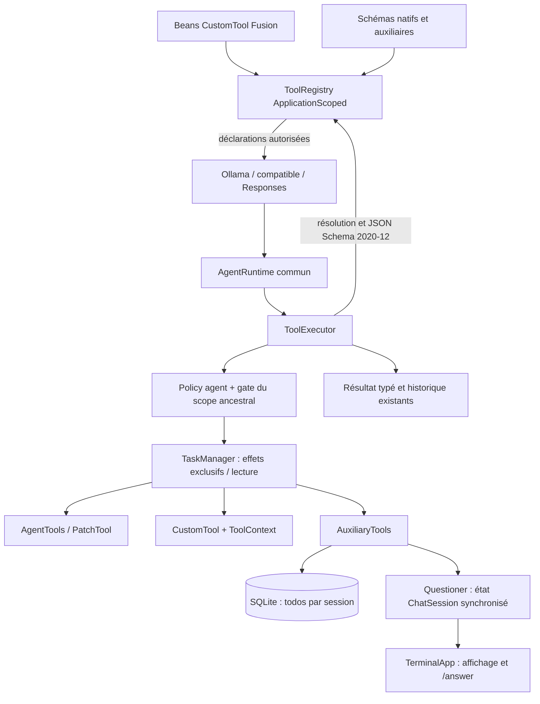

# Suivi de la phase 5 — tools P1/P2

Implémentation du 19 octobre 2026, après [les sous-agents](subagents.md), sur le périmètre de la [roadmap](roadmap.md). L’audit initial, sa matrice et son `report.json` restent historiques. Cette livraison ne certifie pas une parité globale et n’implémente pas le client MCP de phase 6.

## Architecture livrée



`ToolRegistry` est partagé dans le container Fusion, avec découverte de `List<CustomTool>`, collisions refusées, noms natifs réservés, retrait des extensions et snapshots de schémas indépendants. Chaque exécution capture ensemble le validateur, le handler et sa classification d’effets ; une modification ultérieure du catalogue ne change pas un appel déjà résolu. Les providers déclarent le même catalogue que l’exécuteur. Chaque tour Responses capture une seule fois les schémas pour le budget et le payload ; `ResponsesProviderTest.snapshotsTheDynamicToolCatalogueOncePerTurnForBothBudgetAndRequest` empêche une divergence lors des mutations du registre. `ToolSchemas` reste la façade compatible pour les intégrations construites manuellement.

Les permissions acceptent désormais les cinq nouveaux noms natifs et les noms d’extensions `custom_[a-z][a-z0-9_]{0,55}`, dans le parser et le schéma de configuration. Les autres noms inconnus restent refusés. Les extensions sont interdites par défaut en l’absence de règle autorisante. Un `* allow` reste une autorisation large, explicitement configurée.

La dépendance NetworkNT 1.5.1 déjà utilisée pour tester la configuration devient une dépendance d’exécution, avec Jackson transitif. Aucune nouvelle plateforme applicative n’est introduite. Les schémas externes (`$ref` réseau/fichier), changements de dialecte et identifiants redirigeant la résolution sont refusés. Les erreurs de validation ne recopient pas les arguments rejetés. Catalogue : 128 entrées, schéma 32 000 caractères, description 4 000 caractères, total schémas/descriptions 131 072 caractères ; les budgets de contexte existants refusent les requêtes trop grandes.

## Comportements et preuves

| Critère de phase 5 | Code | Validation exécutée |
|---|---|---|
| Extension sans changement du moteur, DI et découverte | `CustomTool`, `ToolDefinition`, `ToolContext`, `ToolRegistry` | `FixtureCustomTool` + JVM isolée `SessionProcess fusion-tools` : bean découvert, dépendance injectée, déclaration puis exécution ; retrait visible des deux côtés |
| Collisions et désactivation | `ToolRegistry.register/unregister`, `PermissionPolicy` | Refus doublon, nom natif, retrait natif ; extension retirée introuvable ; DENY absente des déclarations et refusée même avec callback permissif |
| Validation réelle des paramètres | `ToolRegistry.resolve` | Type, obligatoire, propriété inconnue, bornes, objets imbriqués et `$defs` locaux ; zéro effet avant validation ; références externes refusées |
| Coordination des effets | `TaskManager.effect(boolean,…)`, snapshot `Invocation` | Une extension exclusive bloque une écriture native jusqu’à sa terminaison ; résultats bornés sans couper une paire de surrogates |
| Patch UTF-8 exact | `PatchTool`, helpers bornés `AgentTools` | Ajout/suppression, Unicode, CRLF, plusieurs hunks, EOF sans newline ; assertions du contenu sur disque |
| Refus avant effet de batch | `PatchTool.execute` | Traversal, lien, binaire, fichier >1 MB, contexte ambigu/manquant, syntaxe et argument inconnu ; premier fichier du batch absent et témoin extérieur intact |
| Permissions au point d’exécution | `ToolExecutor`, gates des `TaskScope` | Plan refuse patch via son DENY edit/write malgré callback true ; DENY ancestral question/extension préservé ; modification externe pendant approbation conservée |
| Skills bornés et scoped | `AuxiliaryTools.skill` | Découverte, priorité projet sur utilisateur, Unicode, contenu marqué non fiable, traversal/symlink/taille refusés |
| Todos persistants et isolés | `TodoRepository`, `V005__session_todos.sql` | Relecture après fermeture/réouverture, parent/enfant distincts, IDs dupliqués et entrées invalides refusés, suppression en cascade, migration v4→v5 sans perte des messages |
| Questions sans accès terminal du handler | `ToolContext.Questioner`, `ChatSession.askQuestion/answer`, `TerminalApp` | Deux enfants en attente, réponses corrélées aux historiques enfants, texte libre/option, annulation de tous les waits et absence de prompt orphelin |
| Intégration multiprovider | `OllamaClient`, providers Responses, `AgentEngineParityTest` | Patch → skill → todowrite → todoread → question → réponse finale, puis tentative interdite Plan, sur NDJSON, SSE compatible et deux modes Responses ; résultats et todos retrouvés après réouverture |

Les scénarios nouveaux résident dans `ToolsPhaseFiveTest` et l’extension de `AgentEngineParityTest`. Les suites antérieures couvrent toujours shell, exécution native, limites, streaming, sessions, usage et sous-agents. Aucun compte réel, serveur MCP externe ni abonnement n’est nécessaire.

## Validation reproductible

Commande complète (JDK 25 et Maven 3.9+) :

```sh
mvn -B --no-transfer-progress clean spotless:apply verify
```

Commande ciblée :

```sh
mvn -B --no-transfer-progress -Dtest=ToolsPhaseFiveTest,AgentEngineParityTest test
```

Les tests HTTP doivent pouvoir ouvrir des sockets loopback. Une première exécution sous sandbox réseau a échoué pour cette raison ; la relance autorisée des 384 tests préexistants a réussi. Les premières validations ciblées ont révélé puis permis de corriger le scope Fusion du registre et d’ajuster la fenêtre de contexte du faux modèle (32 768), sans relever les limites par défaut du produit.

Résultat final du 19 octobre 2026 à 00:26:26 +02:00 : **BUILD SUCCESS**, 413 tests exécutés, 0 échec, 0 erreur, 0 ignoré (46,407 s). Cela ajoute 29 cas aux 384 tests préexistants : `ToolsPhaseFiveTest` 24 cas, quatre scénarios multiprovider supplémentaires et un test du snapshot de catalogue Responses. `AgentEngineParityTest` compte maintenant 16 cas et `ResponsesProviderTest` 13.

Environnement : Azul Zulu **Java 25**, Maven **3.9.16**, Linux amd64. La commande `clean spotless:apply verify` a régénéré les composants Fusion, compilé les sources avec release 25, appliqué/vérifié le format et construit le JAR ombré. Les avertissements Shade sur les ressources de dépendances partagées restent non bloquants ; la campagne n’a exécuté aucun modèle réel.

Smoke du JAR final : `java -jar target/syleks-0.1.0-SNAPSHOT.jar --help` retourne 0. Une JVM séparée, lancée dans un projet temporaire avec `target/test-classes:target/syleks-0.1.0-SNAPSHOT.jar` comme unique classpath applicatif et `SessionProcess <fixture> fusion-tools` comme entrée, affiche **FUSION_TOOLS_OK** et retourne 0. Elle vérifie la découverte du bean de test, son exécution, son retrait visible dans le provider et l’exécuteur, puis l’écriture `fusion-patch` contenant exactement `fixture\n`. Cette sonde utilise les dépendances du JAR ombré, sans classpath Maven de dépendances ; le test JUnit de JVM isolée permet de reproduire le même scénario fonctionnel depuis `mvn test`.

`git diff --check` ne signale aucune erreur d’espaces. Les modifications de documentation ultérieures au build ne changent aucun source exécutable.

## Limites et suites

- Patch exact borné, sans fuzzy matching, déplacement ni création automatique de répertoires. Tous les contrôles précèdent l’écriture ; un échec I/O ou une annulation pendant le commit peut laisser un préfixe appliqué. Les contrôles de chemins ne constituent pas un sandbox OS contre un processus extérieur qui change les inodes au dernier instant. Aucun undo ajouté.
- Les plugins Java sont du code de confiance chargé au démarrage, avec l’autorité OS du processus. L’API sécurise l’autorisation de l’appel et propose un gate de ressources ; elle ne peut enfermer du bytecode malveillant. Les extensions mutantes doivent déclarer `exclusive=true` et respecter interruption et limites d’allocation.
- Les skills sont des documents chargés à la demande, avec référence de provenance ; pas d’exécution de scripts, d’import automatique des références ou d’installation de skills.
- Les todos sont propres à chaque session et ne sont pas copiés au fork. Les réponses aux questions sont persistées dans les résultats d’outils ; une question interrompue ne reprend pas automatiquement après crash.
- Les nouvelles permissions restent DENY sans configuration autorisante ; Explore doit recevoir explicitement les outils supplémentaires souhaités, sous plafond ancestral.
- LSP, nouveaux transports MCP, recherche web avancée et compatibilité de plugins TypeScript restent hors phase 5. Le budget de contexte compte les schémas : activer tout le catalogue peut nécessiter une fenêtre supérieure à la valeur par défaut du modèle.
- La compilation native GraalVM et une revue visuelle humaine en terminal réel ne font pas partie de cette campagne déterministe. Vérification manuelle conseillée : poser une question, répondre par `/answer 2`, annuler une seconde question avec Escape, puis vérifier le même historique après réouverture.
